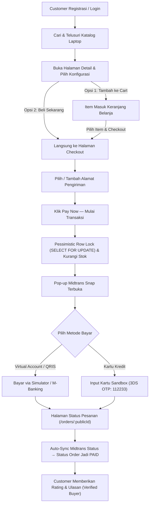

# Product Requirements Document (PRD)

## WindStore — Premium Windows Laptop E-Commerce

**Version:** 1.1.0  
**Last Updated:** November 2026  
**Status:** Implemented / Active  
**Currency:** IDR (Indonesian Rupiah)  

---

## 1. Project Overview

**WindStore** adalah platform e-commerce full-stack single-vendor yang dirancang khusus untuk penjualan laptop berbasis Windows dari berbagai brand terkemuka (ASUS, Lenovo, Dell, HP, Acer, MSI, dll.). Platform ini memberikan pengalaman belanja yang presisi dengan fitur kustomisasi konfigurasi perangkat keras (RAM, Storage, OS, Garansi), transaksi end-to-end dengan payment gateway terintegrasi, ulasan pembeli terverifikasi, serta panel manajemen komprehensif bagi administrator toko.

### Tujuan Utama Project
1. **Sistem Transaksi End-to-End Handal**: Dari pencarian produk, konfigurasi spesifikasi, keranjang belanja, checkout instan / multi-item, pembayaran via Midtrans Snap, hingga sinkronisasi status otomatis.
2. **Integritas Data Finansial & Inventaris**: Mencegah race condition stok dengan *Pessimistic Row-Level Locking* (`SELECT FOR UPDATE`) dan perlindungan audit trail finansial menggunakan *Soft Delete*.
3. **Ulasan Berkualitas**: Review dan rating produk hanya dapat diberikan dan diedit oleh pembeli terverifikasi (*verified buyers*).
4. **Siap Produksi & Nilai Portofolio**: Arsitektur monorepo terpisah antara Next.js 16 (App Router) dan Express 5 + Prisma ORM.

---

## 2. Target Pengguna

- **Customer**: Mahasiswa, profesional, programmer, content creator, dan gamer yang membutuhkan laptop Windows dengan spesifikasi terukur dan terpercaya.
- **Admin**: Pengelola operasional toko untuk mengelola katalog, inventaris stok, moderasi ulasan, dan pemantauan pesanan.

---

## 3. Lingkup Produk

### In Scope (Fitur Utama)

#### A. Pengalaman Belanja (Storefront)
- **Katalog & Pencarian**: Filter multi-dimensi (brand, kategori, prosesor, rentang harga) dan pencarian instan nama/brand di navbar.
- **Kustomisasi Konfigurasi (Build Your Setup)**: Pemilihan varian opsi RAM, SSD, kartu grafis, atau paket garansi yang secara real-time memperbarui total harga.
- **Direct Checkout ("Beli Sekarang")**: Opsi langsung membeli satu laptop dengan konfigurasi yang dipilih tanpa melalui keranjang manual.
- **Keranjang Belanja**: Pemilihan parsial item untuk checkout terpisah (`CartSelectionContext`).
- **Pembayaran Real-time**: Terintegrasi dengan Midtrans Snap (Virtual Account, E-Wallet QRIS, Kartu Kredit 3DS) dengan sinkronisasi status otomatis.
- **Ulasan Pembeli Terverifikasi**: Hanya customer yang telah membeli dan menyelesaikan pesanan yang dapat memberikan rating dan ulasan, serta dapat memperbarui (edit) ulasan mereka sewaktu-waktu.
- **Manajemen Akun Customer**: Buku alamat pengiriman (dengan penanda alamat default), daftar favorit (Wishlist), riwayat pesanan dengan status live, dan fitur hapus akun (*Soft Delete*).

#### B. Administrasi & Operasional (Admin Dashboard)
- **Katalog Produk**: Tambah, edit, nonaktifkan, dan hapus produk beserta unggah multi-gambar ke Cloudinary.
- **Konfigurasi & Spesifikasi**: Manajemen preset penyesuaian harga (price modifier) per model laptop.
- **Manajemen Stok**: Pemantauan laptop dengan stok menipis/habis dan penyesuaian stok.
- **Manajemen Pesanan**: Pemantauan status transaksi dan pemrosesan pesanan pelanggan.
- **Audit & Pengguna**: Manajemen daftar customer dan riwayat order tanpa merusak integritas pembukuan keuangan.

### Out of Scope (Pengembangan Lanjutan)
- Multi-vendor marketplace (saat ini single-vendor).
- Live chat real-time customer-service berbasis WebSocket (saat ini via email/contact form).
- Program cicilan bank di luar payment gateway Midtrans.

---

## 4. Functional Requirements

| ID | Fitur | Deskripsi |
| :--- | :--- | :--- |
| **F001** | **Autentikasi & Otorisasi** | Registrasi dan login menggunakan *identifier* (username atau email) dan password hash (bcrypt). Autentikasi berbasis JWT di dalam `httpOnly` secure cookie. RBAC (`customer` & `admin`). |
| **F002** | **Katalog & Detail Produk** | Menampilkan daftar laptop aktif dengan gambar, harga dasar, lencana (badge), motto, dan spesifikasi JSON. Halaman detail menyajikan galeri gambar, ringkasan fitur, dan ulasan. |
| **F003** | **Konfigurasi Varian Komponen** | Customer dapat memilih opsi kustomisasi (RAM, SSD, dll.) dengan kalkulasi penyesuaian harga (`priceModifier`) instan sebelum dimasukkan ke keranjang. |
| **F004** | **Keranjang Belanja (Cart)** | Pengelolaan kuantitas item, pemilihan item tertentu yang ingin di-checkout, dan sinkronisasi stok otomatis. |
| **F005** | **Beli Sekarang (Direct Checkout)** | Tombol beli cepat pada halaman konfigurasi laptop yang langsung membawa customer ke halaman checkout dengan konfigurasi terpilih. |
| **F006** | **Pencegahan Concurrency Stok** | Transaksi checkout menggunakan *Pessimistic Row-Level Locking* (`SELECT ... FOR UPDATE`) dan PostgreSQL Check Constraint (`stock >= 0`) untuk menjamin stok tidak pernah menjadi negatif meskipun terjadi checkout bersamaan pada detik yang sama. |
| **F007** | **Payment Gateway (Midtrans)** | Pembuatan token Midtrans Snap per transaksi dan penanganan webhook verifikasi tanda tangan SHA-512. Dilengkapi sistem *Active Status Sync* sebagai fallback otomatis di localhost. |
| **F008** | **Auto-Cancellation Cron Job** | Job terjadwal (`node-cron`) setiap 5 menit yang membatalkan pesanan pending yang melewati batas waktu 15 menit dan secara otomatis merestorasi kuantitas stok produk. |
| **F009** | **Ulasan Pembeli Terverifikasi** | Endpoint dan form review dibatasi hanya untuk customer yang telah membeli produk tersebut (order berstatus `paid`/`completed`/`shipped`). Customer juga dapat mengedit ulasan yang telah dibuat. |
| **F010** | **Buku Alamat Pengiriman** | Customer dapat menyimpan banyak alamat pengiriman dan memilih alamat default untuk kemudahan proses checkout. |
| **F011** | **Wishlist (Daftar Favorit)** | Menyimpan produk laptop idaman untuk dilihat kembali di kemudian hari. |
| **F012** | **Soft Delete & Compliance** | Penghapusan akun user menerapkan *Soft Delete* (`isActive: false`) sehingga riwayat pesanan yang sudah dibayar tidak terhapus demi kepatuhan audit finansial (*financial audit trail*). |
| **F013** | **Admin Catalog & Media** | CRUD Produk, Brand, Kategori, dan integrasi Cloudinary untuk upload aset visual laptop. |

---

## 5. End-to-End User Flow

---

## 6. Architecture & Tech Stack

- **Frontend**: Next.js 16 (App Router), React 19, TypeScript, Tailwind CSS 4, shadcn/ui, Radix UI, Lucide Icons, Sonner.
- **Backend API**: Node.js, Express 5, TypeScript, Prisma ORM (`@prisma/adapter-pg`).
- **Database**: PostgreSQL 17 (Containerized via Docker, Host Port: 5433).
- **Payment Gateway**: Midtrans Snap Sandbox & Midtrans Client SDK.
- **Media CDN**: Cloudinary Media API.
- **Scheduled Tasks**: `node-cron` untuk background cleanup expired orders.
